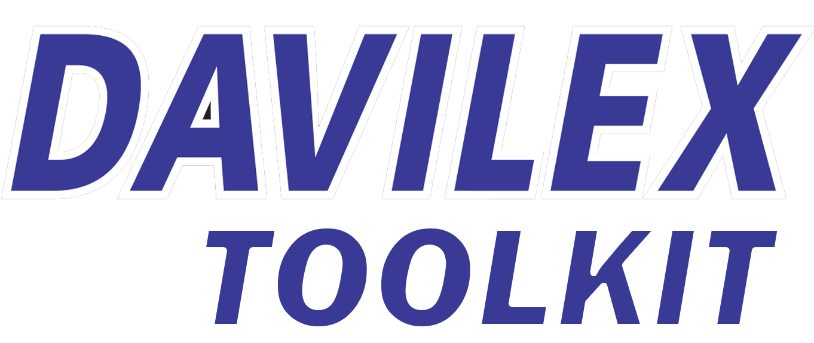

# Davilex Toolkit

A launcher, compatibility toolkit and RCS archive explorer for the classic Davilex racing games. Play supported editions on modern Windows, choose your resolution, enable modern controllers, and explore the original game assets.

**You must supply your own installed games. No games, maps, cars, music or movies are included in the download.**

## Supported games

- A2 Racer II
- A2 Racer IV
- Autobahn Raser II
- London Racer
- Holiday Racer
- Paris–Marseille Racing
- Europe Racer

Support currently targets the editions used during development. Other regional releases or executable versions may be rejected. M25 Racer is a research reference, not a supported launcher profile.

## Download and setup

1. Download the latest ZIP from [Releases](https://github.com/MissingThePixel/Davilex_Toolkit/releases) and extract the whole folder to a writable location.
2. Run **Davilex Toolkit.exe**. Keep `_internal` beside the executable; Python does not need to be installed.
3. Choose a game. If it is not found automatically, select **Locate…** and choose its installation folder. Locating one game also checks sibling folders for other supported games.
4. Choose a resolution and any optional features, then click **Play full game**. **Quick Race** starts a selected track and car directly.

Games can remain in their existing folders, or sit together in a `games` folder beside the toolkit. Valid manual locations are remembered. Paths inside the toolkit folder remain portable when moved to another drive.

For updates, close the toolkit and games, then replace the application files with the new release. Keep your games and the toolkit's `work` folder: it contains settings and original-file backups.

## Features

- Compatibility fixes for starting races, menu-to-engine handoff, timing and known rendering issues.
- Preset and custom resolutions, corrected aspect ratio, and HUD scaling and placement.
- Optional English text for supported non-English editions. Coverage varies; speech and text embedded in images are not fully translated.
- **Controller enabler:** XInput controllers through Xidi's legacy DirectInput / WinMM bridge. Menus use keyboard and mouse.
- Per-game Quick Race track and car selection.
- Europe Racer content imports from supported donor installations, grouped by source game, with an **Import all available content** option. Supported additions appear in the original Downloaded tracks/cars menus; available preview artwork is imported automatically. Donor games are required. Oxford town and London Thames are excluded from the available conversions.

### Graphics backends and platforms

**DDrawCompat** is the default Windows backend. **Wine compatibility (D3D9)** uses DXWrapper and is also worth trying in a Windows virtual machine.

The Windows application has also been used with **CrossOver 26 on macOS** and **Winlator on Android**. For CrossOver, select **Wine** as the bottle's graphics renderer and **Wine compatibility (D3D9)** inside the toolkit. Winlator needs a working D3D9 translation setup; PulseAudio gave clear sound on the tested AYN Thor.

Compatibility and performance vary by device, renderer and game edition. Occasional simulation slowdowns and original-game physics quirks remain. The toolkit and RCS Explorer render at Windows system DPI; restart them after changing display scaling.

## RCS Explorer

Run **RCS Explorer.exe** or select **Open RCS Explorer** in the toolkit. Open an archive's IMG file with its matching IND file alongside it.

- Filter by filename, extension or content category, and click column headings to sort.
- Preview supported images, BIN images, font sheets, audio and textured D3D models.
- Orbit and zoom models; related archives can supply textures when identical meshes establish a match.
- Extract original entries, convert supported audio to PCM WAV, save images as PNG, and export model geometry as OBJ.

Not every BIN, IMG or model variant is decoded. Unknown entries can still be extracted. Some models have missing textures, and OBJ export does not include materials.

## File changes and backups

The toolkit patches the selected installation **in place**; launching at another resolution does not create a second game copy. Compatibility and resolution changes persist. Only changed originals are backed up under `work/install-backups`.

English, controller and Quick Race settings use temporary changes with recovery records. If Windows holds a renderer DLL after exit, cleanup is retried before the next launch. Keep the `work` folder to retain those records. Content imports deliberately create converted assets inside Europe Racer.

Unsupported or unexpectedly modified binaries are preserved rather than overwritten. Windows may request administrator permission when the selected game folder requires it.

## Reporting problems

Open an [issue](https://github.com/MissingThePixel/Davilex_Toolkit/issues) with the game and edition, operating system, graphics backend, chosen resolution, and steps to reproduce the problem. Include the exact error and relevant `work/toolkit-last-run.log` or `work/application-error.log`. Review logs for personal paths before sharing them.

Not every track, car, resolution, race mode or controller combination has been tested. Paris–Marseille Racing can show intermittent road/camera judder. Original collision and traffic behaviour can also be unpredictable.

## Credits and license

Created by **MissingThePixel**, with development and reverse-engineering assistance from **OpenAI Codex**.

Thanks to **narzoul** for DDrawCompat, **Elisha Riedlinger and contributors** for DXWrapper, **Samuel Grossman and contributors** for Xidi, and the developers of Python, Tcl/Tk, Pillow, NumPy, miniaudio, CFFI, pycparser and PyInstaller.

Original toolkit code is licensed under the [MIT License](LICENSE). Third-party components retain their own licenses; see [Credits](CREDITS.md) and the `licenses` folder included in the download. The original games and their assets remain the property of their respective rights holders. This project is independent of Davilex.
